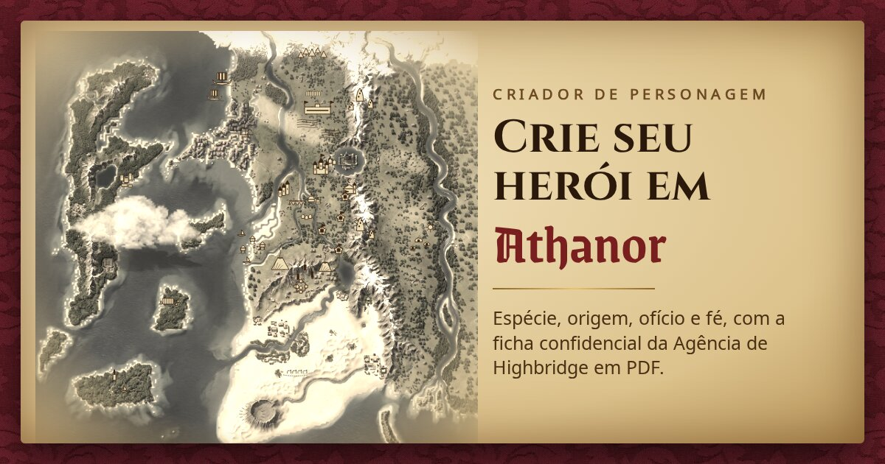

# Criador de Personagem — Athanor



Fiz isto por hobby, para a mesa de RPG que jogo com uns amigos em Athanor, um cenário que eu mesmo criei. O site guia a criação do personagem: espécie, origem, ofício, fé, aparência e nome. No fim ele gera uma ficha em PDF, escrita como um relatório da Agência de Inteligência e Detetives de Highbridge.

A ficha é só para roleplay e não tem atributos nem regras de jogo. Tudo roda no navegador e o personagem fica salvo ali mesmo.

Está no ar em <https://criador-de-personagem.vercel.app>.

## Rodar localmente

```bash
npm install
npm run dev
```

Detalhes técnicos estão em [docs/DESENVOLVIMENTO.md](docs/DESENVOLVIMENTO.md). Para mexer no conteúdo do cenário, veja [docs/DADOS.md](docs/DADOS.md).
